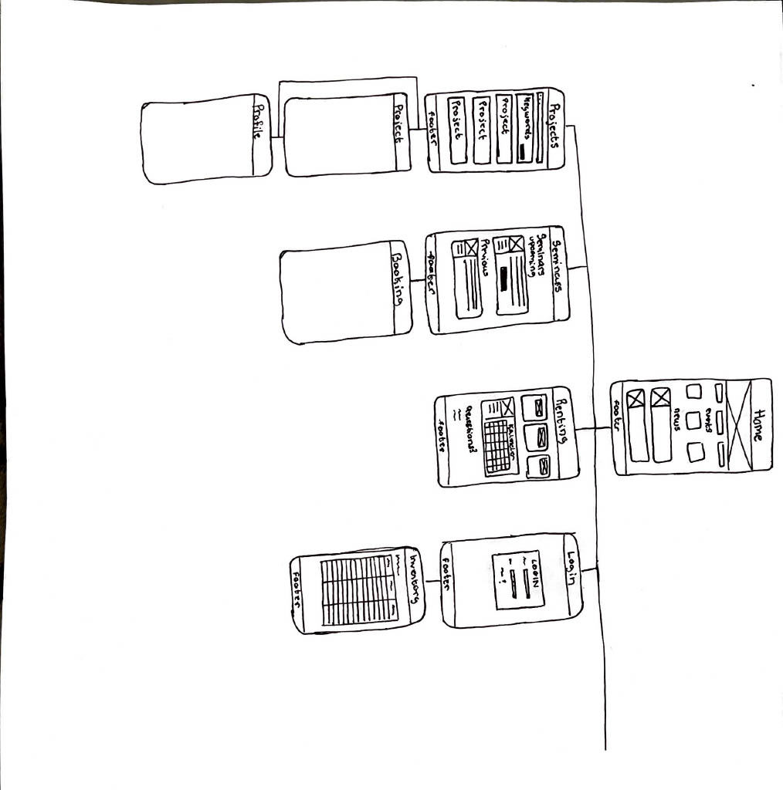
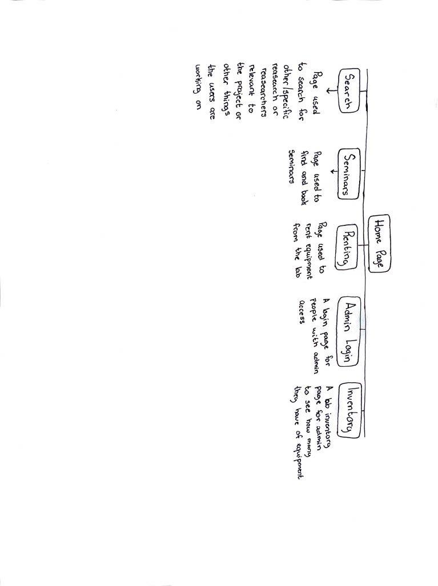
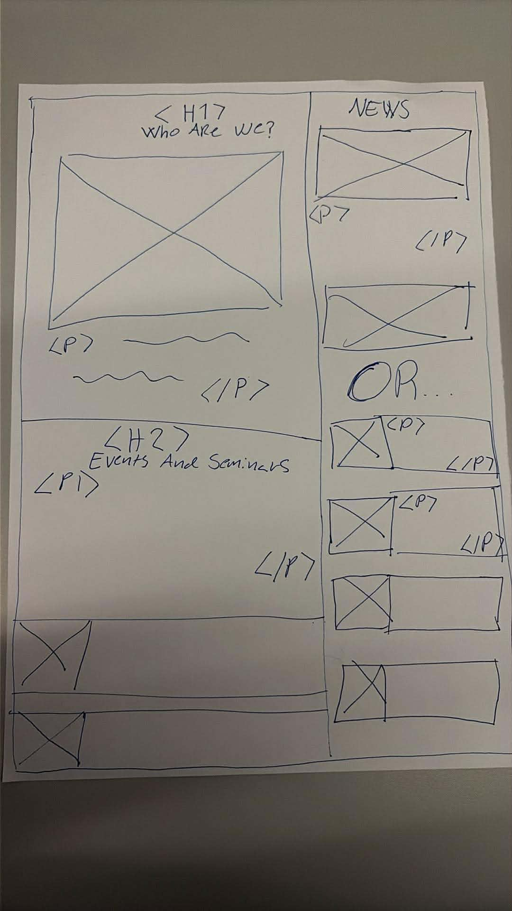

# Product Specification

## 1. Intro

### 1.1 Purpose

This document defines the business requirements , user requirements, constraints, and non-functional requirements for the HCAI lab website. It serves as a shared reference for the development team, stakeholders, and product owner throughout the project.

### 1.2 Authors

Marte Kaland, Iselin Chantelle Holt, Kaja Emilie Berg, Marie Antionette Klausen

### 1.3 Date & milestones

| Date       | Milestone                                             |
| ---------- | ----------------------------------------------------- |
| 10.02.26   | Product Specification completed                       |
| 25.02.26   | Hi‑Fi prototype ready                                 |
| Week 9–12  | MVP development (core public pages, research listing) |
| Week 13–16 | Equipment rental + seminar booking implementation     |
| Week 17–18 | Admin panel + content moderation                      |
| 22.04.26   | Prototype ready for user testing                      |
| Week 20    | Final product presentation                            |

### 1.4 Project stakeholders

- **Students** - users seeking research topics, supervisors, and equipment
- **Researchers / Academic staff** - contributors of research content and seminar information
- **Visitors / Public audience** - non-technical users accessing public information
- **Admin users** - moderators responsible for approving content and managing inventory

### 1.5 Summary

The project provides a web-based hub for the HCAI lab at Gjøvik, making research, staff profiles, seminars, and equipment access easy to find. It will make it easier for students to find the right person to contact, find equipment and booking events. The info board will make showcasing what HCAI lab does easier and more efficient. It will strengthen the lab's visbility and improve communication between students, staff, and the public.

## 2. Business requirements (Worked on by Kaja)

### 2.1 Business Objectives

- BO‑1: Increase visibility and public awareness of the HCAI Lab
- BO‑2: Improve communication and collaboration between students and staff
- BO‑3: Simplify seminar promotion and attendance tracking
- BO‑4: Provide a centralized hub for equipment availability and rental

### 2.2 Business Requirements

- BR‑1: The system shall present public information about the HCAI Lab in a clear, accessible format (supports BO‑1).
- BR‑2: The system shall provide categorized research topics and researcher profiles (supports BO‑2).
- BR‑3: The system shall allow staff to publish seminars and track registrations (supports BO‑3).
- BR‑4: The system shall provide an equipment inventory with availability status (supports BO‑4).

## 3. Personas & Usage scenarios

### 3.1 Persona 1: Master's student - "Sara"

- _Role:_ Master's student in computer science at NTNU Gjøvik

- _Goals:_

- Find a thesis topic in AI/HCI

- Identify a relevant supervisor

- Borrow lab equipment for projects

- _Tech Skills:_ High, comfortable with web tools and academic platforms

- _Motivation:_ Wants to do something "real" with impact and connect with the right researcher

- _Pain points:_

- Hard to know who works on what

- Information scattered across different NTNU pages

#### 3.1.1 Scenario 1:

- _Trigger:_

After spending hours looking though diffrnt websites trying to find reserch about AI/HCI to make a thesies about she visits the AI lab

- _Interaction:_

she finds the website and navigates to the reaserch tab. From there she picks out relevant keywords and finds a proffesor who has articles about HCI, she finds his contact information and where his office is. Happy with the research she goes back and clicks the rent equipment for testing. She finds a VR headset and rent if for one week.

- _Reselution:_

Instead of serching though multiple diffrent NTNU pages she quickly found both a relevant supervisor and found the equipment she needed.

### 3.2 Persona 2: Researcher - "Jonas"

- _Role:_ Associate professor / researcher at HCAI lab

- _Goals:_

- Make his research and interests visible to students and visitors

- Fill seats at seminars without manual coordination

- _Tech Skills:_ Medium-high, busy, doesn't want extra admin work

- _Motivation:_ Attract motivated students and collaborators

- _Pain points:_

- Repeating the same info to many students

- Manually tracking who signed up for events

#### 3.2.1 Scenario 2:

- _Trigger:_

After struggeling to get students to find his research and saminars, so that he can help students with their thesis and other research projects, he checks out the new AI lab website.

- _Interaction:_

He finds the website and scrolles down and click the seminar tab. Here he can see other seminars and desides he wants to add his there aswell. He locates the login page and logs in as an admin/teacher. From there he clicks "add seminar" and writes when and where the seminar is and click done. He goes back and checks out the research page. There he sees that the work is catogorized in keywords and decides he wants to update his own.

- _Reselution:_

Instead of students struggeling to fins him, with the new updated keywords he will easily be found. And after he added the seminar to the website multiple people joined and he had a seminar where almost all the seats where filled.

### 3.3 Persona 3: Visitor/public - "Kari"

- _Role:_ Member of the public visiting NTNU (e.g., open day, company visit)

- _Goals:_

- Quickly understand what the AI lab does

- See examples of projects and topics

- _Tech skills:_ Varies, expects simple, clear interfaces

- _Motivation:_ Curiosity, potential collaboration, or just understanding AI better

- _Pain points:_

- Academic websites feel overwhelming

- Doesn't know where to start or who to talk to

#### 3.3.1 Scenario 3:

- _Trigger:_

She walks by the AI lab and sees the screen with some info. This intrigues her and she wishes to know more about the AI lab

- _Interaction:_

She scans the QR code on the screen in the AI lab and is directed to the AI Lab website, On the home page she scrolls down and sees a short description on what the AI lab is and does. From there she scrolls further can there she can see upcoming events and a small description on what they are about. At the bottom she sees news where she learns about whats happening with research and other AI news

- _Resolution:_

Instead of having to wonder and locate a website or multiple her self, a clear QR code is available for easy scanning and navigation to the website. She got to easily see whats happening just by scrolling on the home page.

## 4. User requirements

### 4.1 User stories

### **Students**
| ID   | User Story                                                                                | Issue                                                          |
| ---- | ----------------------------------------------------------------------------------------- | -------------------------------------------------------------- |
| US-1 | As a student, I want to browse research topics so I can find a thesis direction.          | [#39](https://git.ntnu.no/iselinch/Awesome-Foursome/issues/39) |
| US-2 | As a student, I want to view researcher profiles so I can identify a relevant supervisor. | [#40](https://git.ntnu.no/iselinch/Awesome-Foursome/issues/40) |
| US-3 | As a student, I want to see available equipment so I can plan my project work.            | [#41](https://git.ntnu.no/iselinch/Awesome-Foursome/issues/41) |
| US-4 | As a student, I want to request to rent equipment so I can use it for my assignments.     | [#42](https://git.ntnu.no/iselinch/Awesome-Foursome/issues/42) |
| US-5 | As a student, I want to book seats at seminars so I can attend relevant events.           | [#43](https://git.ntnu.no/iselinch/Awesome-Foursome/issues/43) |
### **Researchers**
| ID   | User Story                                                                                        | Issue                                                          |
| ---- | --------------------------------------------------------------------------------------------------| --------------------------------------------------------------- |
| US-6 | As a researcher, I want to have my research up to date so students can find accurate information. | [#44](https://git.ntnu.no/iselinch/Awesome-Foursome/issues/44) |
| US-7 | As a researcher, I want to publish seminar information so I can reach more attendees.             | [#45](https://git.ntnu.no/iselinch/Awesome-Foursome/issues/45) |
### **Visitors**
| ID    | User Story                                                                                                          | Issue                                                          |     |
| ----- | ------------------------------------------------------------------------------------------------------------------- | -------------------------------------------------------------- | --- |
| US-8  | As a visitor, I want to understand the purpose of the HCAI Lab so I can orient myself.                              | [#46](https://git.ntnu.no/iselinch/Awesome-Foursome/issues/46) |     |
| US-9  | As a visitor, I want to browse highlighted projects so I can learn what the lab does.                               | [#47](https://git.ntnu.no/iselinch/Awesome-Foursome/issues/47) |     |
| US-10 | As a visitor, I want to quickly understand what the HCAI Lab does so that I can decide whether it’s relevant to me. | [#48](https://git.ntnu.no/iselinch/Awesome-Foursome/issues/48) |     |
### **Admins**
| ID    | User Story                                                                        | Issue                                                          |     |
| ----- | --------------------------------------------------------------------------------- | -------------------------------------------------------------- | --- |
| US-11 | As an admin, I want to approve profile updates so I can maintain content quality. | [#49](https://git.ntnu.no/iselinch/Awesome-Foursome/issues/49) |     |
| US-12 | As an admin, I want to manage equipment inventory so the system stays accurate.   | [#50](https://git.ntnu.no/iselinch/Awesome-Foursome/issues/50) |     |

### 4.2 Acceptance criteria
#### 4.2.1 Student browsing research topics - US-1

| **Section**         | **Content**                                                                                        |
| ------------------- | -------------------------------------------------------------------------------------------------- |
| **User Story**      | As a student, I want to browse research topics so that I can find a thesis direction.              |
| **AC‑1**            | User opens the Research page → A list of research topics is displayed.                             |
| **AC‑2**            | User selects a keyword filter → Topics update to show only matching items.                         |
| **AC‑3**            | User clicks a topic → A detailed topic page opens with description, keywords, and researcher info. |
| **AC‑4**            | Page loads quick → Meets performance requirement (NFR‑7).                                          |
| **Developer Notes** | Requires research DB, keyword tagging, researcher profile linking.                                 |
| **Dependencies**    | Research listing, keyword filtering, researcher profiles.                                          |
| **Assumptions**     | All topics have at least one keyword.                                                              |
#### 4.2.2 Student renting equipment - US-4

| **Section**         | **Content**                                                                            |
| ------------------- | -------------------------------------------------------------------------------------- |
| **User Story**      | As a student, I want to request to rent equipment so that I can use it for my project. |
| **AC‑1**            | User opens Equipment page → Available equipment is shown with availability status.     |
| **AC‑2**            | User selects an item → Item details and availability are displayed.                    |
| **AC‑3**            | User submits rental request → System confirms.                                         |
| **AC‑4**            | Item unavailable → User is informed immediately and cannot submit request.             |
| **Developer Notes** | Requires equipment DB, rental request form, availability tracking.                     |
| **Dependencies**    | Authentication, equipment database, admin approval workflow.                           |
| **Assumptions**     | Students cannot modify inventory data.                                                 |
#### 4.2.3 Visitor understanding the HCAI lab - US-10

| **Section**         | **Content**                                                                                                         |
| ------------------- | ------------------------------------------------------------------------------------------------------------------- |
| **User Story**      | As a visitor, I want to quickly understand what the HCAI Lab does so that I can decide whether it’s relevant to me. |
| **AC‑1**            | Visitor opens the homepage → A clear, short description of the lab is visible without scrolling.                    |
| **AC‑2**            | Visitor scrolls down → Highlighted projects or topics appear with simple explanations.                              |
| **AC‑3**            | Visitor clicks “Learn more” → A dedicated page opens with accessible, non‑technical information.                    |
| **AC‑4**            | Visitor navigates using top menu → All public pages are reachable within 2–3 clicks.                                |
| **Developer Notes** | Focus on accessibility, simple language, and clear visual hierarchy.                                                |
| **Dependencies**    | Homepage content, project highlights, navigation menu.                                                              |
| **Assumptions**     | Visitors do not log in and have no technical background.                                                            |
#### 4.2.4 Admin managing equipment inventory - US-12

| **Section**         | **Content**                                                                                                                  |
| ------------------- | ---------------------------------------------------------------------------------------------------------------------------- |
| **User Story**      | As an admin, I want to manage equipment inventory so the system stays accurate.                                              |
| **AC‑1**            | Admin logs in → Inventory management panel becomes accessible.                                                               |
| **AC‑2**            | Admin selects an equipment item → Current status, description, and availability are displayed.                               |
| **AC‑3**            | Admin updates item details (status, description, availability) → System saves changes and updates the public equipment list. |
| **AC‑4**            | Admin marks an item as unavailable or under maintenance → Students cannot submit rental requests for that item.              |
| **Developer Notes** | Requires admin role, equipment DB editing, and real‑time availability updates.                                               |
| **Dependencies**    | Authentication, equipment database, rental request system.                                                                   |
| **Assumptions**     | Only admins can modify equipment data; students can only view it.                                                            |

### 4.3 Notes for development team
#### 4.3.1 Student browsing research topics

| **Category**                    | **Details**                                                                                                   |
| ------------------------------- | ------------------------------------------------------------------------------------------------------------- |
| **Required Data**               | Research topics table (title, description, keywords, researcherID). Researcher table (name, office, contact). |
| **Required APIs / Endpoints**   | GET /research, GET /research/:id, GET /research?keyword=HCI                                                   |
| **UI Components Needed**        | Research list page, keyword filter component, topic detail page.                                              |
| **User Permissions**            | Public access (no login required).                                                                            |
| **Error Handling**              | “No topics found” message, slow‑load fallback.                                                                |
| **Non‑Functional Requirements** | Must load within 2 seconds (NFR‑7). Must be accessible (WCAG 2.1 AA).                                         |
| **Open Questions**              | Should topics be sortable (A–Z, newest)? Should researchers be filterable too?                                |

#### 4.3.2 Student renting equipment

| **Category**                    | **Details**                                                                                                              |
| ------------------------------- | ------------------------------------------------------------------------------------------------------------------------ |
| **Required Data**               | Equipment table (name, description, availability, condition). Rental requests table (userID, equipmentID, date, status). |
| **Required APIs / Endpoints**   | GET /equipment, GET /equipment/:id, POST /rentals                                                                        |
| **UI Components Needed**        | Equipment list, equipment detail page, rental request form.                                                              |
| **User Permissions**            | Student login required                                                                                                   |
| **Error Handling**              | “Item unavailable”, “Request failed”, “Login required”.                                                                  |
| **Non‑Functional Requirements** | Confirmation within 3 seconds (NFR‑8).                                                                                   |
| **Open Questions**              | Should students see rental history? Should admins approve rentals or auto‑approve?                                       |

#### 4.3.3 Student booking a seminar seat

| **Category**                    | **Details**                                                                                       |
| ------------------------------- | ------------------------------------------------------------------------------------------------- |
| **Required Data**               | Seminar table (title, description, date, seatsAvailable). Registration table (userID, seminarID). |
| **Required APIs / Endpoints**   | GET /seminars, GET /seminars/:id, POST /seminars/:id/register                                     |
| **UI Components Needed**        | Seminar list, seminar detail page, booking button, confirmation message.                          |
| **User Permissions**            | Student login required.                                                                           |
| **Error Handling**              | “Seminar full”, “Already registered”, “Registration failed”.                                      |
| **Non‑Functional Requirements** | Must update seat count instantly. Must load within 2 seconds.                                     |
| **Open Questions**              | Should students be able to cancel? Should admins see a participant list?                          |

#### 4.3.4 Admin managing equipment inventory

| **Category**                    | **Details**                                                                     |
| ------------------------------- | ------------------------------------------------------------------------------- |
| **Required Data**               | Equipment table (name, description, availability, condition, image).            |
| **Required APIs / Endpoints**   | GET /admin/equipment, PUT /admin/equipment/:id                                  |
| **UI Components Needed**        | Admin inventory dashboard, edit equipment form, status toggle.                  |
| **User Permissions**            | Admin‑only (role‑based access).                                                 |
| **Error Handling**              | “Save failed”, “Invalid data”, “Unauthorized access”.                           |
| **Non‑Functional Requirements** | Must be secure (NFR‑9, NFR‑11). Must support keyboard navigation (NFR‑5).       |
| **Open Questions**              | Should admins upload images? Should there be categories (VR, sensors, cameras)? |

## 5. Anti-requirements

The system will **not** support the following, due to legal, security, or scope limitations:

AR‑1: User‑initiated profile deletion - restricted due to institutional data retention policies.
AR‑2: Financial transactions - outside the scope of the lab’s operations.
AR‑3: Physical access control - handled by NTNU infrastructure.
AR‑4: Integration with external event platforms - out of scope for MVP.
AR‑5: Open‑ended conversational chatbot - to avoid misinformation and ensure curated content.
AR‑6: Personalized content on the info board - info board is public and non‑interactive.
AR‑7: Anonymous accounts - conflicts with NTNU authentication policies.
AR‑8: Social features (comments, likes, messaging) - not relevant to lab’s goals.
AR‑9: Student modification of inventory or seminar data - restricted for security reasons.

## 6. Non-Functional requirements

The following non-functional requirements describe planned system qualities and constraints that are not related to specific system functionality.

### 6.1 Usability

NFR-1: Key public information (lab purpose, events, and projects) shall be accessible within a maximum of 3 clicks from the homepage.
NFR-2: First-time visitors shall be able to identify at least one researcher profile or project page relevant to their interest within 60 seconds.
NFR-3: Public functionality should be understandable without prior training, as measured by successful completion of basic tasks in usability testing

### 6.2 Accessibility

NFR-4: The system shall comply with WCAG 2.1 level AA accessibility standards.
NFR-5: All interactive elements shall be accessible using keyboard-only navigation.
NFR-6: Text content shall meet minimum contrast ratios as defined by WCAG 2.1 AA.

### 6.3 Performance

NFR-7: Public pages shall load within 2 seconds when accessed over a standard network connection.
NFR-8: Event booking and equipment renting actions shall provide user feedback within 3 second.

### 6.4 Security and Authentication

NFR‑9: All user accounts shall be protected by strong passwords that meet defined complexity rules.
NFR‑10: Passwords shall be stored using secure hashing and never in plain text.
NFR‑11: All personal data and login actions shall be encrypted in transit using HTTPS/TLS 1.2+.
NFR‑12: Access to admin functionality shall require role‑based authorization.
NFR‑13: The system shall automatically log out inactive sessions after a defined timeout period.

### 6.5 Compatibility and Deployment

NFR-14: The system shall be usable on desktop displays and large information screens (info board) without loss of core functionality.

## 7. Website diagram

## 8. Low-Fi prototype

## 9. Who worked on what

### 9.1 Iselin

- 1. Intro, 1.1 purpose, 1.2 authors, 1.3 dates and milestones, 1.4 stakeholders, 1.5 summary
- 3.1, 3.2, 3.3 personas
- 4.2 & 4.3 Acceptance criteria and notes for development team
- 5. anti requirements

### 9.2 Marie

- 3.1.1, 3.2.1, 3.3.1 Usage scenarios
- 8 low-fi prototypes

### 9.3 Marte

- 6. non-functional requirements
- 7. website diagram
- 8 low-fi prototypes

### 9.4 Kaja

- 2. business requirements
- 4.1 user stories
